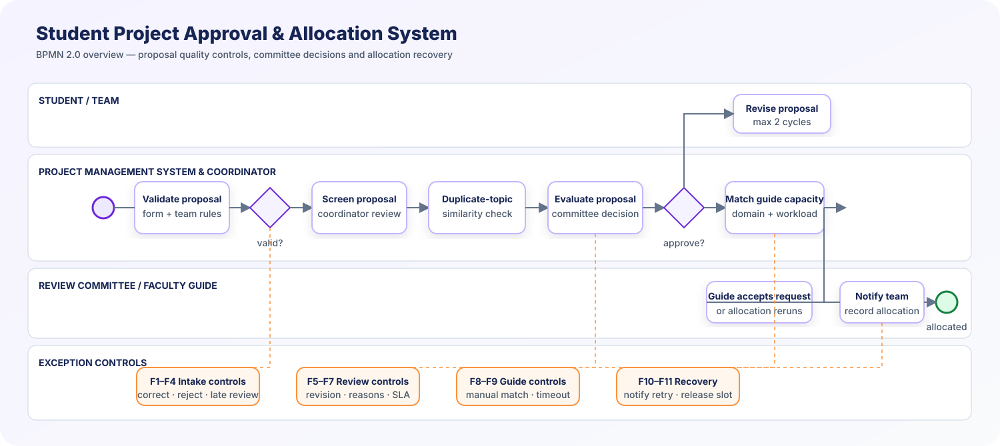
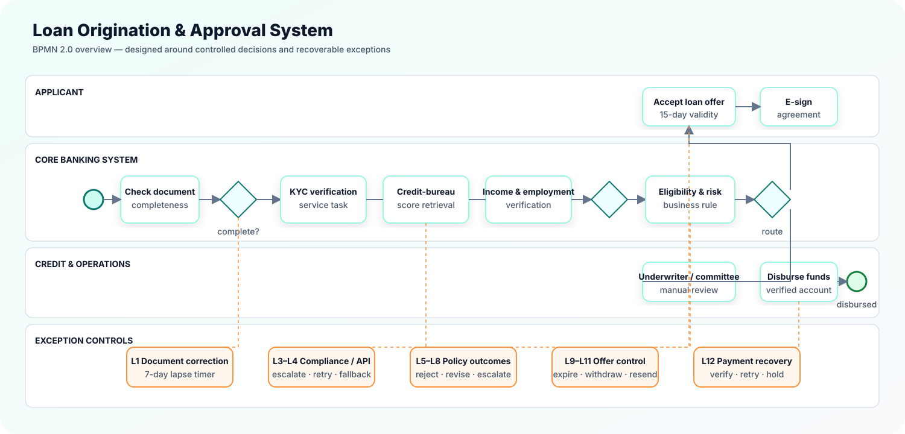

# BPMN Exception-First Process Models

<div align="center">


<br/>


*Two complete coursework models, designed for the happy path **and** the decisions, timeouts, failures and cancellations around it.*

</div>

---

## At a glance

| | |
|:--|:--|
| **Assignments completed** | Assignment 1 and Assignment 3 |
| **Process starts** | Applicant submits an application and supporting documents |
| **Successful end** | Loan is disbursed and the applicant is notified |
| **Alternate ends** | Rejected, lapsed, withdrawn, offer expired, or funds held for repair |
| **Modelling standard** | BPMN 2.0 |
| **Primary tool** | Camunda Modeler / any BPMN 2.0-compatible modeller |

## Included assignments

| Assignment | Scenario | BPMN source | Failure register |
|:--|:--|:--|:--|
| **1** | Student Project Approval & Allocation | [`assignment-1-student-project-approval.bpmn`](assignment-1-student-project-approval.bpmn) | [`ASSIGNMENT_1_FAILURE_PATH_REGISTER.md`](ASSIGNMENT_1_FAILURE_PATH_REGISTER.md) |
| **3** | Loan Origination & Approval | [`loan-origination-approval.bpmn`](loan-origination-approval.bpmn) | [`FAILURE_PATH_REGISTER.md`](FAILURE_PATH_REGISTER.md) |

## Assignment 1 process view

<p align="center">
  
</p>

> The editable Assignment 1 source is [`assignment-1-student-project-approval.bpmn`](assignment-1-student-project-approval.bpmn). Its supporting controls are documented in the [Assignment 1 Failure Path Register](ASSIGNMENT_1_FAILURE_PATH_REGISTER.md).

## Assignment 3 process view

<p align="center">
  
</p>

> The SVG is an executive overview for quick reading. The editable, authoritative BPMN model is [`loan-origination-approval.bpmn`](loan-origination-approval.bpmn).

## What the model covers

The straight-through route is deliberately short: submit → validate → verify in parallel → assess risk → approve → offer → accept → sign → disburse. The model then layers in the controls a real lending process needs:

- Document correction and a seven-day lapse timer
- Parallel KYC, credit-bureau and income/employment checks
- Fraud/AML escalation and investigation
- Bureau-service retry and manual fallback
- Reject, counter-offer and senior-credit escalation outcomes
- Offer-expiry, e-signature retry and applicant withdrawal paths
- Disbursement recovery, including a hold and compensation of account creation

## Participants and responsibilities

| Participant / lane | Key responsibility |
|:--|:--|
| **Applicant** | Submits, corrects documents, accepts the offer and signs |
| **Loan Officer** | Resolves documents, KYC exceptions and manual credit checks |
| **Fraud & Compliance** | Investigates confirmed-risk / sanctions escalations |
| **Underwriter / Credit Committee** | Makes manual and escalated credit decisions |
| **Operations / Disbursement** | Releases funds and handles payment exceptions |
| **Credit Bureau** *(external pool)* | Supplies the score through a service interaction |
| **Core Banking System** | Validates, scores, generates documents and creates the loan account |

## Happy path

```text
Application + documents
        ↓
Completeness check
        ↓
KYC  â•‘  credit score  â•‘  income verification     (parallel)
        ↓
Eligibility & risk scoring
        ↓
Underwriter approval
        ↓
Generate + send offer → applicant accepts → e-signs
        ↓
Verified-account disbursement → account creation → notification
        ↓
Loan disbursed
```

## Failure-path register

The register below is intentionally matched to the brief. Each resolution is expressed in the BPMN using tasks, gateways, boundary events, loops, escalation or compensation as appropriate.

| ID | Failure / trigger | Response designed into the process | BPMN construct |
|:--:|:--|:--|:--|
| L1 | Documents are missing or illegible | Request only the missing items; resubmission is allowed for 7 days, then the case lapses | XOR gateway + timer boundary event + loop |
| L2 | Identity does not match official records | Send to Loan Officer for manual verification; unresolved cases are rejected with a reason | XOR gateway + user task |
| L3 | Forgery, AML or sanctions flag | Escalate to Compliance; investigate, report internally and terminate confirmed fraud | Escalation + sub-process + terminate end |
| L4 | Credit-bureau API is unavailable | Retry up to three times; then use manual checking or park the case | Error boundary event + retry loop |
| L5 | Score below policy cutoff | Reject with reasons or present a secured / lower-value counter-offer | XOR gateway |
| L6 | Income or DTI is insufficient | Offer revised amount / term and re-score once; otherwise reject | Loop with limit + XOR gateway |
| L7 | High-value or borderline application | Escalate to senior committee; timer creates an SLA reminder | Escalation + non-interrupting timer |
| L8 | Collateral value or title is inadequate | Revalue, reduce LTV and re-underwrite; reject unclear title | Sub-process + XOR gateway |
| L9 | Applicant does not accept in 15 days | Expire the offer and notify the applicant | Interrupting timer boundary event |
| L10 | Applicant withdraws | Release holds and reverse eligible processing charges | Message boundary event + compensation |
| L11 | E-signature fails or mismatches | Resend and remind; cancel the offer after two failed attempts | Error path + bounded loop |
| L12 | Bank account / payment rail fails | Retry after account verification; hold funds and contact applicant if unresolved | Error boundary event + compensation |

## Why these BPMN choices

| Element | Used for | Why it fits |
|:--|:--|:--|
| **User tasks** | Applicant, officer and underwriter decisions | A person must complete or judge the work |
| **Service tasks** | KYC, bureau request, scoring, notifications and disbursement | Automated system-to-system work |
| **Business-rule tasks** | Completeness, eligibility and LTV policy | Decisions are policy-driven and auditable |
| **Parallel gateway** | KYC, credit and income checks | Independent checks should run simultaneously and synchronise |
| **Exclusive gateway** | Completeness, risk and acceptance outcomes | Exactly one business outcome continues |
| **Boundary events** | Lapse, offer expiry, credit API and payment errors | Exceptions are attached to the activity that can fail or time out |
| **Compensation** | Withdrawal / disbursement rollback | Reverses completed side effects without hiding the audit trail |

## Repository map

```text
BPMN_Exercise_3/
├── loan-origination-approval.bpmn   # Editable BPMN 2.0 source
├── FAILURE_PATH_REGISTER.md         # Expanded operational register
├── images/
│   └── loan-origination-overview.svg
└── README.md                        # You are here
```

## Open and review

1. Open `loan-origination-approval.bpmn` in Camunda Modeler or another BPMN 2.0 editor.
2. Use **Fit viewport** to review the end-to-end flow.
3. Inspect the named exception branches and boundary events against the Failure Path Register.
4. Export a PNG or PDF from the modeller if your submission portal requests one.

---

<div align="center">
  <sub>BPMN 2.0 process models • clear process logic and observable exception handling.</sub>
</div>
